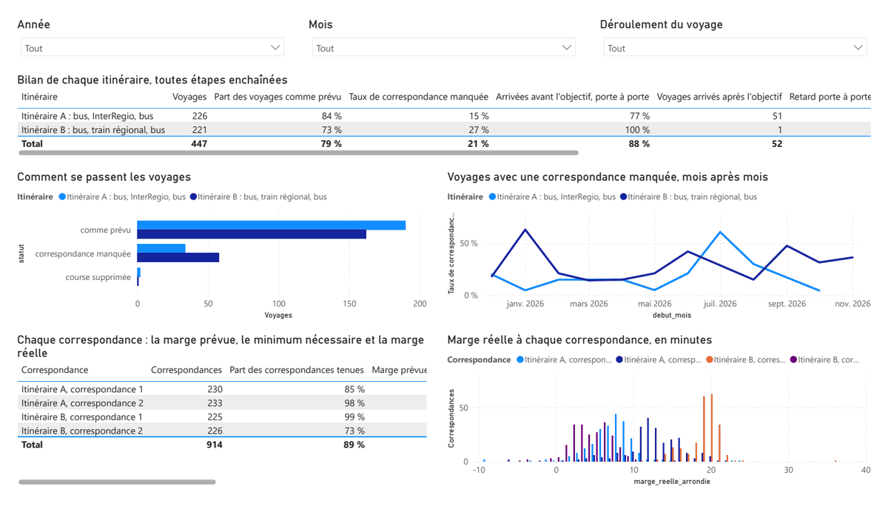
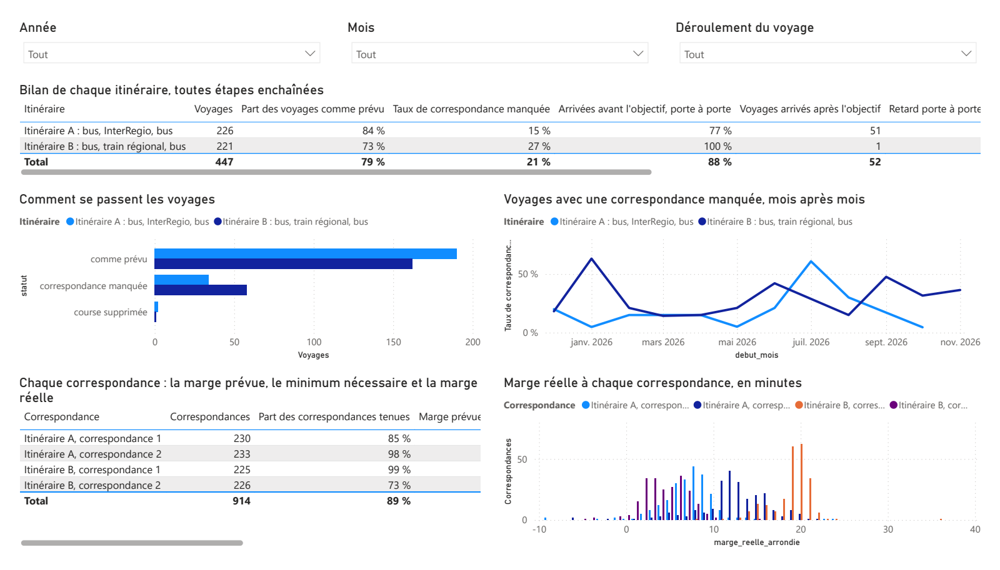
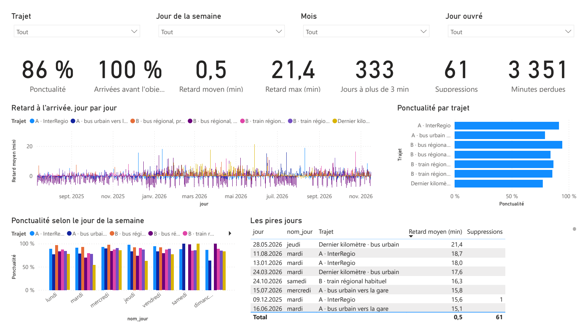
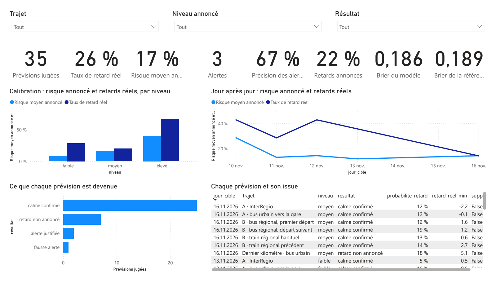
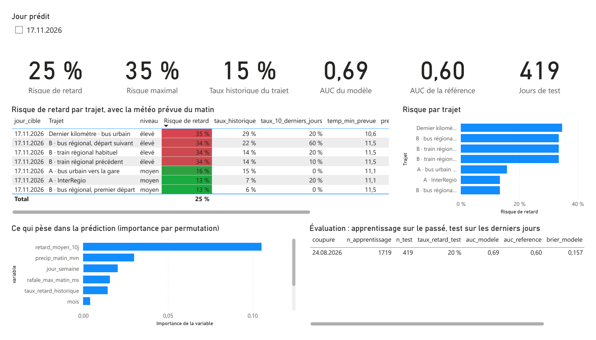
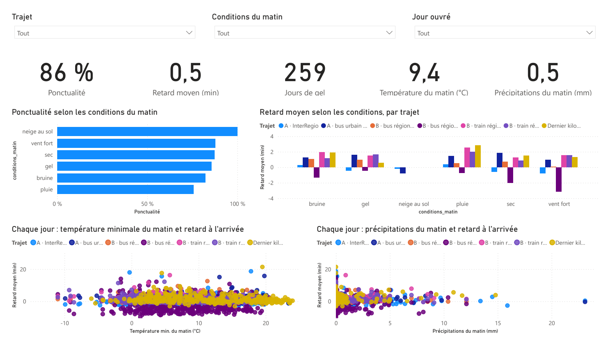

# Ponctualité : quel train prendre pour ne jamais être en retard

L'application CFF me dit que **mon train a du retard**. Ce projet me dit **lequel prendre pour ne pas en avoir** :
il mesure la fiabilité réelle de mes trajets quotidiens sur plusieurs mois, cherche les schémas
(jour de la semaine, heure, saison, météo) et prédit chaque soir le risque de retard du lendemain.

Projet personnel construit sur Microsoft Fabric (essai), avec les données ouvertes des transports publics suisses.

## Aperçu



*Cinq des sept pages du rapport, en mode public : chaque trajet porte un libellé générique, sans arrêt ni horaire
(voir « Confidentialité »). Captures du 17.11.2026.*

<details>
<summary><b>Les pages une par une</b></summary>

**Porte à porte.** Les itinéraires complets, correspondances comprises : part des voyages qui se passent comme prévu,
correspondances manquées mois après mois, marge réelle à chaque correspondance.



**Mes trajets.** Chaque étape mesurée seule : ponctualité, retard jour par jour, jours de la semaine, pires jours.



**Prévisions contre réalité.** Chaque prévision passée rapprochée de ce qui s'est produit : calibration par niveau,
alertes justifiées ou non, score de Brier face à la référence naïve.



**Demain.** Le risque de retard de chaque trajet pour le prochain jour ouvré, avec la météo prévue et ce qui pèse
dans la prédiction.



**Météo.** Ponctualité et retard selon les conditions du matin.



</details>

## Les données

| Source | Contenu | Usage |
|---|---|---|
| [Ist-Daten v2](https://data.opentransportdata.swiss/en/dataset/ist-daten-v2) (opentransportdata.swiss) | Tous les passages réalisés en Suisse la veille : horaire prévu, horaire réel, suppression, pour chaque arrêt de chaque course (~2,6 millions de lignes par jour) | Historique : les 35 derniers jours en ligne, les mois précédents dans les [archives](https://archive.opentransportdata.swiss/actual_data_archive.htm) |
| OJP 2.0 (API) | Départs en temps réel à un arrêt | Flux temps réel : un relevé toutes les 5 minutes dans l'Eventhouse |
| [MétéoSuisse, SwissMetNet](https://data.geo.admin.ch/ch.meteoschweiz.ogd-smn/) (données ouvertes) | Observations horaires des stations automatiques (température, précipitations, vent, neige au sol), fichiers `h_historical`, `h_recent`, `h_now` par station | Météo du matin de chaque trajet : gel, neige, pluie, vent |

Les Ist-Daten couvrent les trains, bus, trams et le métro m1 lausannois ; le m2 n'y figure pas.

## Architecture

```text
opentransportdata.swiss (CSV quotidien, 300 à 400 Mo)
        │  notebook Charger_Istdaten : téléchargement, filtrage sur mes arrêts et lignes
        ▼
Lakehouse Ponctualite
   bronze.passages        passages bruts du périmètre, partitionnés par jour (chargement idempotent)
   bronze.chargements     journal : un jour n'est jamais chargé deux fois
        │  notebook Transformer_Passages
        ▼
   silver.passage         types corrects, colonnes en français, retards en minutes, drapeau « ponctuel » (< 3 min, comme aux CFF)
   gold.dim_date / dim_ligne / dim_arret
   gold.fait_passage      un passage à un arrêt
   gold.fait_trajet       un trajet suivi par jour : « mon train de 07:55 », avec son retard réel à l'arrivée
   gold.fait_itineraire   un voyage porte à porte par jour : les trajets suivis enchaînés, correspondances comprises
   gold.fait_correspondance   une correspondance par jour : marge prévue, marge réelle, tenue ou manquée
   gold.qualite           la recette : un contrôle par ligne et par exécution, avec son verdict
        │
        ▼
Power BI (Direct Lake) : fiabilité par trajet, par jour de semaine, par heure ; meilleure alternative

API OJP 2.0 (prochains départs, temps réel)
        │  notebook Python Collecter_Temps_Reel, toutes les 5 minutes
        ▼
Eventhouse Ponctualite_TR, table departs : un instantané par relevé et par départ annoncé
        → tableau de bord temps réel (KQL) et, plus tard, « combien de minutes avant le départ
          sait-on qu'un train sera en retard ? »
```

Chaque matin, le pipeline `Chaine_Matin` enchaîne le chargement des passages, la météo et la transformation. Les
tables gold ne sont publiées dans le rapport qu'une fois leur recette de qualité validée.

## Résultats sur 16 mois (14.07.2025 → 13.11.2026, jours ouvrés)

Sept trajets suivis sur 350 jours ouvrés, soit 2'119 trajets mesurés : 85 % arrivent avec moins de 3 minutes de retard
et 21 ont été supprimés. Les libellés restent génériques, le périmètre réel n'est pas publié.

| Trajet suivi | Jours mesurés | Ponctuel (< 3 min) | Retard moyen à l'arrivée | Pire jour | Supprimé |
|---|---|---|---|---|---|
| **Itinéraire A** | | | | | |
| Bus urbain vers la gare | 236 | 82 % | +1,6 min | +15,8 min | 1 |
| Train du matin (IR) | 349 | 93 % | −0,2 min | +18,7 min | 12 |
| **Itinéraire B** | | | | | |
| Bus régional vers la gare, premier départ | 332 | 94 % | +0,7 min | +12,6 min | 0 |
| Bus régional vers la gare voisine, départ suivant | 332 | 78 % | −0,2 min | +14,0 min | 0 |
| Train régional habituel (R) | 315 | 86 % | +1,6 min | +11,7 min | 4 |
| Train régional précédent (R), en alternative | 315 | 86 % | +1,4 min | +12,2 min | 3 |
| **Dernier kilomètre** | | | | | |
| Bus urbain de la gare au travail | 240 | 72 % | +2,1 min | +21,4 min | 1 |

Les deux bus urbains ne sont mesurés que depuis décembre 2025.

Ce que disent les chiffres :

- **L'InterRegio est régulier, mais souvent supprimé.** Il est ponctuel 93 % du temps et il a été supprimé 12 fois
  en 16 mois, plus que les six autres trajets réunis.
- **Le maillon faible est le dernier kilomètre.** Le bus de la gare au travail n'est ponctuel que 72 % du temps,
  même s'il s'améliore nettement depuis l'été 2026.
- **Le train régional habituel se dégrade.** Il était ponctuel 98 % du temps à l'été 2025, il l'est 72 % du temps
  cet automne. Son alternative, le train précédent, est descendue à 75 %.
- **Pour le bus régional, le premier départ est le bon.** Le départ suivant, vers la gare voisine, a perdu
  vingt à trente points de ponctualité depuis le début de 2026.

| Ponctualité par trimestre | T3 2025 | T4 2025 | T1 2026 | T2 2026 | T3 2026 | T4 2026 (au 13.11) |
|---|---|---|---|---|---|---|
| Train régional habituel (R) | 98 % | 92 % | 83 % | 86 % | 74 % | 72 % |
| Bus régional vers la gare voisine, départ suivant | 98 % | 92 % | 62 % | 73 % | 72 % | 66 % |
| Bus urbain de la gare au travail | | 100 % (13 jours) | 58 % | 62 % | 85 % | 81 % |

La pluie du matin coûte quinze points de ponctualité, le gel presque rien :

| Conditions du matin (05:00–09:59) | Trajets mesurés | Ponctuel (< 3 min) |
|---|---|---|
| Sec | 1'464 | 87 % |
| Gel (minimum de 0 °C ou moins) | 202 | 85 % |
| Bruine (moins de 2 mm) | 252 | 82 % |
| Pluie (2 mm ou plus) | 163 | 72 % |

Les matins de vent fort (31 trajets) et de neige au sol (7) sont trop rares pour conclure.

### Porte à porte : ce que coûtent les correspondances

Mesurer chaque étape seule ne dit pas si j'arrive à l'heure. Les trajets sont donc enchaînés en itinéraires, et le
voyageur est simulé jour après jour : il vise la course prévue, la prend si elle est encore à quai quand il arrive
réellement, et sinon monte dans le premier véhicule qui relie les deux arrêts, quelle que soit sa ligne.
Résultats du 15.12.2025 au 16.11.2026, jours ouvrés où toutes les heures utiles ont été mesurées :

| Itinéraire | Voyages | Comme prévu | Correspondance manquée | Arrivé avant l'heure objectif | Retard moyen | Pire jour |
|---|---|---|---|---|---|---|
| A : bus urbain, InterRegio, bus urbain | 226 | 84 % | 15 % | 77 % | +3,8 min | +37 min |
| B : bus régional, train régional, bus urbain | 221 | 73 % | 27 % | 99,5 % | +5,9 min | +48 min |

| Correspondance | Marge prévue | Minimum supposé | Tenue |
|---|---|---|---|
| A, du bus urbain à l'InterRegio | 8 min | 5 min | 85 % |
| A, de l'InterRegio au bus urbain | 12 min | 3 min | 98 % |
| B, du bus régional au train régional | 19 min | 2 min | 99 % |
| B, du train régional au bus urbain | 5 min | 3 min | 73 % |

Deux leçons que les mesures par étape ne montraient pas :

- **L'itinéraire qui rate le plus de correspondances est le plus sûr.** Sur B, une correspondance sur quatre est
  manquée, toujours la même : le bus part quatre à cinq minutes après l'arrivée prévue du train. Mais le bus suivant
  passe un quart d'heure plus tard et l'horaire prévu garde une demi-heure de réserve : un seul voyage sur 221 arrive
  après l'heure objectif.
- **L'itinéraire qui tient ses correspondances arrive le plus souvent en retard.** Sur A, l'horaire prévu n'arrive que
  cinq minutes avant l'heure objectif : le moindre écart suffit, et près d'un voyage sur quatre arrive trop tard.

Les délais de correspondance sont des hypothèses (clé `correspondance_min` de la configuration), et le résultat y est
sensible : la page « Porte à porte » du rapport montre la marge réelle de chaque correspondance, minute par minute.
Autres hypothèses : un véhicule ne part pas avant son heure prévue, et le voyageur ne prend pas de course plus tôt
que prévu.

Un trajet suivi est défini par un arrêt de départ, une ligne et une heure habituelle ; la course retenue chaque jour
est la première de la ligne à partir de cette heure (tolérance de 10 minutes), ce qui absorbe les horaires de vacances
décalés de quelques minutes. Un passage est ponctuel si son retard à l'arrivée est inférieur à 3 minutes, comme aux CFF.

## Confidentialité

Le périmètre (arrêts, lignes, trajets suivis, itinéraires qui les enchaînent) est décrit dans `config/trajets.json`,
**qui n'est pas publié** :
il contient mes arrêts de domicile et mes horaires. `config/trajets.exemple.json` montre le format ;
copie-le en `trajets.json` et mets tes propres trajets. La clé OJP est dans `.env` (non publié), copiée dans le
lakehouse sous `Files/config/ojp.env` ; elle n'apparaît ni dans le code, ni dans les sorties des scripts.

Le rapport a deux modes d'affichage. Par défaut, il montre mes trajets sous le nom que je leur ai donné. En mode
public (`python rapport/generer_rapport.py <id du modèle> --public`), il n'affiche que le libellé générique de chaque
trajet et de chaque itinéraire (clé `nom_public` de la configuration) et laisse de côté les heures de passage.
Les données sont les mêmes : seule la colonne affichée change, dans les dimensions `gold.dim_trajet` et
`gold.dim_itineraire`. C'est ce mode qui sert aux captures et aux démonstrations.
Le mode public écarte aussi, dans le graphique d'importance des variables, celles que le modèle crée pour chaque
trajet et qui portent son nom configuré. Les captures de ce README sont produites par
[`scripts/capturer_rapport.py`](scripts/capturer_rapport.py) sur le rapport déployé en mode public, puis relues une à une.

## Lancer le projet

La CLI Fabric passe par `fab.ps1`, qui utilise un profil Azure isolé (tenant personnel).

```powershell
# 1. Envoyer le périmètre dans le lakehouse
.\ponctualite\fab.ps1 cp .\ponctualite\config\trajets.json "Ponctualite.Workspace/Ponctualite.Lakehouse/Files/config/trajets.json" -f

# 2. Déployer les notebooks
.\ponctualite\fab.ps1 import "Ponctualite.Workspace/Charger_Istdaten.Notebook" -i .\ponctualite\fabric\Charger_Istdaten.Notebook --format .py -f
.\ponctualite\fab.ps1 import "Ponctualite.Workspace/Transformer_Passages.Notebook" -i .\ponctualite\fabric\Transformer_Passages.Notebook --format .py -f

# 3. Charger l'historique (asynchrone, ~2 min par jour de données), puis transformer
.\ponctualite\fab.ps1 job start "Ponctualite.Workspace/Charger_Istdaten.Notebook"
.\ponctualite\fab.ps1 job run "Ponctualite.Workspace/Transformer_Passages.Notebook"
```

La capacité d'essai n'exécute qu'un travail Spark à la fois : attendre la fin du chargement avant de transformer.

```powershell
# 3 bis. Profondeur historique : les archives mensuelles (1,4 Go par mois, ~25 s par jour de données)
.\ponctualite\fab.ps1 import "Ponctualite.Workspace/Charger_Archives.Notebook" -i .\ponctualite\fabric\Charger_Archives.Notebook --format .py -f
.\ponctualite\fab.ps1 job start "Ponctualite.Workspace/Charger_Archives.Notebook"
```

`Charger_Archives` remplace chaque jour déjà présent : le relancer applique le périmètre courant à tout l'historique.

```powershell
# 3 ter. Météo : stations MétéoSuisse associées aux arrêts (clé stations_meteo de trajets.json), à lancer avant la transformation
.\ponctualite\fab.ps1 import "Ponctualite.Workspace/Charger_Meteo.Notebook" -i .\ponctualite\fabric\Charger_Meteo.Notebook --format .py -f
.\ponctualite\fab.ps1 job run "Ponctualite.Workspace/Charger_Meteo.Notebook"
```

`gold.meteo_jour` résume chaque journée par station (min, max, précipitations, rafales, neige) avec un zoom sur
05:00–09:59 et une étiquette « conditions du matin » (neige au sol, gel, pluie, vent fort, bruine, sec).
`Transformer_Passages` l'accroche à chaque trajet suivi par la station de l'arrêt de départ.

Chaîne quotidienne planifiée dans Fabric (heure suisse) : le pipeline `Chaine_Matin` part à 06:00 et enchaîne
`Charger_Istdaten`, `Charger_Meteo` et `Transformer_Passages` (voir « Orchestration » plus bas), et
`Predire_Retards` tourne seul à 20:00 pour le lendemain. Le collecteur temps réel tourne toutes
les 5 minutes. Les étapes facultatives de la transformation (itinéraires, prévisions jugées) ne l'arrêtent jamais :
en cas d'erreur, la trace complète est écrite dans `Files/journal/<étape>.txt` du lakehouse.
La capacité d'essai ne sert qu'un travail à la fois : pendant chaque travail Spark de la chaîne, le relevé du
collecteur échoue (erreur 430), soit trois à cinq relevés perdus par jour sur 288.
Attention : un gros travail Spark (rechargement d'archives) sature la capacité d'essai, fait échouer les
exécutions planifiées et Fabric suspend alors la planification après quelques échecs ; la réactiver avec
`fab job run-update <notebook ou pipeline> --id <planification> --enable`.
Les fichiers des archives s'appellent `AAAA-MM-JJ_IstDaten.csv` (majuscules) alors que les quotidiens en ligne
s'appellent `AAAA-MM-JJ_istdaten.csv`.

`Transformer_Passages` et `Predire_Retards` se terminent par un rafraîchissement du modèle sémantique
(`sempy.fabric.refresh_dataset`), pour que le rapport lise les tables du jour et la prévision du soir. Sans lui, le
modèle Direct Lake pouvait rester en retard : le 16.11.2026, la première requête de la journée renvoyait encore l'état
du 10.11. Depuis que l'actualisation automatique du modèle est désactivée (voir « Qualité des données »), ce
rafraîchissement est le seul chemin vers le rapport : s'il est refusé, le notebook échoue, et
`Transformer_Passages` en garde la trace dans `Files/journal/publication.txt`. Seul un modèle pas encore déployé
est ignoré.

```powershell
# 4. Temps réel : tester la clé OJP, envoyer la clé dans le lakehouse, déployer et planifier le collecteur
python -I .\ponctualite\scripts\tester_ojp.py 8501118 "Renens VD"
.\ponctualite\fab.ps1 cp .\ponctualite\.env "Ponctualite.Workspace/Ponctualite.Lakehouse/Files/config/ojp.env" -f
.\ponctualite\fab.ps1 import "Ponctualite.Workspace/Collecter_Temps_Reel.Notebook" -i .\ponctualite\fabric\Collecter_Temps_Reel.Notebook --format .py -f
.\ponctualite\fab.ps1 job run-sch "Ponctualite.Workspace/Collecter_Temps_Reel.Notebook" --type cron --interval 5 --start 2026-11-09T10:00:00 --end 2026-12-28T23:59:00 --enable
```

Treize arrêts relevés toutes les 5 minutes = ~3'700 requêtes par jour, sous la limite gratuite de l'API (20'000 par jour).

```powershell
# 5. Power BI : modèle sémantique Direct Lake (TMDL) puis rapport PBIR généré par script
.\ponctualite\fab.ps1 import "Ponctualite.Workspace/Ponctualite.SemanticModel" -i .\ponctualite\rapport\Ponctualite.SemanticModel -f
.\ponctualite\fab.ps1 get "Ponctualite.Workspace/Ponctualite.SemanticModel" -q id
python .\ponctualite\rapport\generer_rapport.py <id du modèle>
.\ponctualite\fab.ps1 import "Ponctualite.Workspace/Ponctualité.Report" -i .\ponctualite\rapport\Ponctualite.Report -f
```

Après la création de nouvelles tables dans le lakehouse, forcer la synchronisation du point de terminaison SQL
(`fab api -X post "workspaces/<espace>/sqlEndpoints/<id>/refreshMetadata?preview=true" -i "{}"`), sinon Direct Lake
ne voit pas les tables. Dans le rapport, la mise en forme conditionnelle des matrices exige un sélecteur à deux clés
(`dataViewWildcard` + `metadata`), sans quoi elle est ignorée en silence.

Deux pièges rencontrés avec 16 mois d'historique, corrigés le 17.11.2026 :

- **Centile et limite de mémoire.** `PERCENTILE.INC` et `PERCENTILEX.INC` matérialisent chaque ligne : sur 13 millions de
  passages, la requête dépasse la limite de 1'024 Mo de la capacité d'essai et le visuel échoue. La mesure
  `Retard P90 (min)` lit désormais l'histogramme des retards (2'500 valeurs distinctes et leurs effectifs), pour le
  même résultat en quelques secondes.
- **Clé de dimension et casse.** Spark distingue deux graphies d'un même nom d'arrêt, Power BI non : la dimension
  contenait alors un doublon de clé, et choisir une gare dans un segment faisait échouer la relation.
  `Transformer_Passages` construit `dim_arret` sur le nom normalisé (minuscules, espaces réduits).

```powershell
# 6. Tableau de bord temps réel (Real-Time Dashboard sur l'Eventhouse), généré par script
python .\ponctualite\temps_reel\generer_tableau_de_bord.py
.\ponctualite\fab.ps1 import "Ponctualite.Workspace/Ponctualite_TR.KQLDashboard" -i .\ponctualite\temps_reel\Ponctualite_TR.KQLDashboard -f
```

La définition suit la structure des tableaux de bord publiés par Microsoft dans `fabric-toolbox` (schéma 60) ; un
`icon` vide dans une règle de couleur ou une clé `title` à la racine font échouer le chargement.

## Orchestration : la chaîne du matin en pipeline

Les trois notebooks du matin partaient à heure fixe, à 06:00, 06:15 et 06:30. Rien ne les liait : un chargement en
échec n'empêchait pas la transformation de tourner sur des données de la veille. Le pipeline
[`Chaine_Matin`](fabric/Chaine_Matin.DataPipeline/pipeline-content.json) les enchaîne.

| Activité | Part si | Nouveaux essais |
|---|---|:---:|
| `Charger_Istdaten` | 06:00, heure suisse | 4 |
| `Attente_Capacite_1`, 4 minutes | le chargement a réussi | |
| `Charger_Meteo` | l'attente est finie | 4 |
| `Attente_Capacite_2`, 4 minutes | la météo est terminée, réussie ou non | |
| `Transformer_Passages` | l'attente est finie | 2 |
| `Signaler_Meteo` | la météo a échoué et la transformation est terminée | |

- **Un chargement en échec arrête la chaîne.** Sans les passages de la veille, la transformation ne part pas.
- **Une panne de la météo ne prive pas du rapport du jour.** La transformation part quand même, avec la météo des
  jours précédents, puis `Signaler_Meteo` met le pipeline en échec pour que la panne se voie.
- **Une recette bloquée reste un échec.** `Transformer_Passages` se termine en erreur, et le pipeline avec lui.

Ce que la capacité d'essai impose, constaté aux essais du 18.11.2026 :

- **Les attentes.** La capacité ne sert qu'un travail à la fois et ne rend pas le calcul tout de suite : un notebook
  lancé une seconde après le précédent est refusé (erreur 430). Avec les horaires fixes, le quart d'heure d'écart
  masquait ce délai.
- **Les nouveaux essais.** Le collecteur temps réel occupe la capacité toutes les 5 minutes : un notebook qui tombe sur
  son passage est refusé, puis repart deux minutes plus tard. Ces essais repassent aussi une recette bloquée, deux
  fois au plus : c'est le prix accepté pour ne pas perdre une journée sur un simple refus de la capacité.
- **La durée.** 19 minutes de bout en bout, dont 8 d'attente : les données du jour sont prêtes vers 06:20 au lieu de
  06:38. Sur une capacité plus grande, les attentes seraient inutiles.

Sous quelle identité tourne le pipeline : un notebook lancé par un pipeline s'exécute sous l'identité de **qui a
modifié le pipeline en dernier**, et non de qui l'a planifié. Importé par le flux GitHub, le pipeline faisait tourner
les notebooks sous le principal de service : la transformation et la recette réussissaient, mais le rafraîchissement
du modèle sémantique était refusé (403), sans bruit, et le rapport ne se mettait plus à jour. Deux conséquences :

- **Le pipeline s'importe à la main**, sous un compte utilisateur. Le flux GitHub ne l'importe pas : il vérifie que la
  version déployée est bien celle du dépôt, et échoue sinon.
- **Un rafraîchissement refusé fait maintenant échouer le notebook**, au lieu de passer inaperçu.

```powershell
# Importer le pipeline (après les notebooks : il les désigne par leur identifiant), puis le planifier
python .\ponctualite\scripts\controler_pipeline.py .\ponctualite\fabric\Chaine_Matin.DataPipeline --espace <id de l'espace>
.\ponctualite\fab.ps1 import "Ponctualite.Workspace/Chaine_Matin.DataPipeline" -i .\ponctualite\fabric\Chaine_Matin.DataPipeline -f
.\ponctualite\fab.ps1 get "Ponctualite.Workspace/Chaine_Matin.DataPipeline" -q id
.\ponctualite\fab.ps1 api -X post "workspaces/<id de l'espace>/items/<id du pipeline>/jobs/Pipeline/schedules" -i planification.json
```

Avec, dans `planification.json`, l'heure suisse grâce au fuseau `W. Europe Standard Time` :

```json
{"enabled": true, "configuration": {"type": "Daily", "times": ["06:00"], "startDateTime": "2026-11-18T00:00:00", "endDateTime": "2026-12-28T23:59:00", "localTimeZoneId": "W. Europe Standard Time"}}
```

Les trois anciennes planifications des notebooks sont désactivées et non supprimées :
`fab job run-update <notebook> --id <planification> --disable`.

Sur un autre espace de travail, remplacer dans `pipeline-content.json` l'identifiant de l'espace et ceux des trois
notebooks : `controler_pipeline.py` signale ceux qui ne correspondent pas.

## Qualité des données : contrôler avant de publier

Le rapport ne montre les tables du jour que si elles ont passé une recette. `Transformer_Passages` écrit les tables
gold, les contrôle, puis seulement les publie. En Direct Lake, publier veut dire rafraîchir le modèle sémantique :
tant qu'il ne l'est pas, le rapport reste sur la version précédente des tables.

| Famille | Contrôle | Gravité |
|---|---|---|
| Complétude | Tables obligatoires présentes et non vides | bloquant |
| Unicité | Clé de chaque dimension, comparée comme le fait Power BI : sans la casse ni les espaces superflus | bloquant |
| Intégrité | Chaque fait rattaché à ses dimensions, neuf rattachements | bloquant |
| Grain | Une seule ligne par jour et par trajet, par itinéraire, par prévision | bloquant |
| Fraîcheur | Données de la veille chargées | alerte |
| Volume | Passages du dernier jour entre 50 % et 150 % de la médiane des quatre dernières semaines | alerte |
| Complétude | Aucun jour manquant sur 35 jours ; tous les trajets suivis trouvés le dernier jour ouvré | alerte |
| Mesure | Au moins la moitié des heures réelles mesurées | alerte |

- **Un échec bloquant** casse ou fausse le rapport. Les tables ne sont pas publiées, sauf celle de la recette pour
  que la page « Qualité des données » montre l'échec, et le notebook se termine en erreur.
- **Une alerte** est consignée sans rien bloquer : un fichier source en retard n'est pas une faute de la transformation.
- `Predire_Retards`, le soir, ne publie que ses trois tables. Il ne peut donc pas publier à la place de la
  transformation des tables qu'une recette aurait refusées le matin.
- Chaque exécution ajoute ses résultats à `gold.qualite`, laisse son verdict dans `Files/journal/qualite.txt` et le
  résultat de la publication dans `Files/journal/publication.txt`.

Pourquoi cette recette : Spark distingue deux graphies d'un même nom d'arrêt, Power BI non. La dimension des arrêts a
ainsi porté un doublon de clé pendant une semaine, et choisir une gare dans le rapport échouait sans que rien ne le
signale. Le contrôle d'unicité compare désormais les clés comme Power BI les compare.

Exercice d'alerte : déposer un fichier vide `Files/config/simuler_echec_recette` dans le lakehouse fait échouer la
recette suivante, pour vérifier que le blocage fonctionne. Le fichier est retiré aussitôt.

Le blocage a été vérifié par deux exercices, le 17.11.2026 :

1. **Avec les réglages par défaut, la porte fuit.** Le notebook s'est bien terminé en erreur, le verdict « Bloquée » a
   été publié et le fichier d'exercice retiré, mais une table refusée a quand même été relue par le modèle. La cause
   est l'actualisation automatique des modèles Direct Lake, active par défaut : un modèle chargé en mémoire relit une
   table dès qu'elle change, sans attendre le verdict.
2. **Une fois ce réglage désactivé, la porte tient.** La table réécrite par le notebook est restée invisible du
   rapport : dix minutes après l'échec, le modèle montrait toujours la version précédente, et seule la table de la
   recette avait été publiée. Le lendemain matin, la recette validée a tout publié d'un coup.

Le réglage se trouve dans les paramètres du modèle sémantique, section Actualiser : « Maintenir vos données Direct
Lake à jour », à désactiver. Le rapport ne se met alors à jour que par les rafraîchissements demandés en fin de
notebook et par le flux de déploiement. Ce réglage vit dans le service et non dans le dépôt, et aucune API publique ne
permet de le lire : il se règle à la main sur un nouvel espace de travail, et se contrôle à la main. Il survit à un
redéploiement du modèle par le flux GitHub, vérifié le 18.11.2026.

## Le tableau de bord temps réel

Deux pages, rafraîchies toutes les 5 minutes, sur la table `departs` de l'Eventhouse :

1. **En direct** : heure du dernier relevé, départs annoncés à mes arrêts, retard moyen annoncé, annulations ;
   table des prochains départs (retard en rouge dès 3 minutes), retard moyen par ligne, courbe du retard annoncé
   au fil des relevés, perturbations vues sur la période.
2. **Anticipation** : à combien de minutes du départ le retard est-il annoncé ? Retard moyen et part des départs à
   3 minutes ou plus selon le temps restant avant le départ, et part des courses dont le retard était connu dès la
   première annonce. Cette page prend son sens avec quelques semaines de relevés.

Après une semaine de collecte (09.11 → 16.11.2026) : 524'000 départs relevés sur 13 arrêts, environ 98 % des relevés
attendus chaque jour, sans interruption depuis le premier après-midi.

## Le rapport

Huit pages, en Direct Lake sur le modèle gold :

1. **Mes trajets** : ponctualité, retard moyen et maximal, jours à plus de 3 minutes, suppressions, minutes perdues ;
   retard jour par jour, ponctualité selon le jour de la semaine, liste des pires jours. Le segment « Jour ouvré »
   écarte les week-ends, où les trains sont nettement plus souvent supprimés.
2. **Porte à porte** : les itinéraires complets, correspondances comprises. Part des voyages comme prévu, taux de
   correspondance manquée, arrivées avant l'heure objectif, retard et durée porte à porte ; évolution mois après
   mois ; pour chaque correspondance, la marge prévue, le minimum nécessaire et la répartition des marges réelles.
3. **Lignes et gares** : les 13,75 millions de passages du périmètre (90 lignes, 443 arrêts) ; ponctualité par ligne,
   retard selon l'heure de la journée, matrice ligne × jour de la semaine colorée du rouge au vert.
4. **Alternatives** : pour une gare d'arrivée, la ponctualité de chaque ligne heure par heure, puis chaque horaire avec
   sa fiabilité : de quoi choisir le train à prendre plutôt que celui qu'on a l'habitude de prendre. Le retard au
   90e centile de chaque horaire s'affiche une fois la gare choisie.
5. **Météo** : ponctualité et retard selon les conditions du matin, et deux nuages de points (température minimale,
   précipitations) jour par jour.
6. **Demain** : le risque de retard de chaque trajet pour le prochain jour ouvré, avec la météo prévue, l'importance des
   variables et l'évaluation du modèle. Un filtre de page ne garde que la prévision la plus récente (colonne
   `derniere_prevision` de `gold.prediction`) ; l'historique reste accessible en modifiant ce filtre.
7. **Prévisions contre réalité** : chaque prévision passée rapprochée du trajet réel. Risque annoncé et retards réels
   par niveau (la calibration) et jour après jour, précision et couverture des alertes « élevé », score de Brier face
   à la référence naïve, et le détail prévision par prévision : alerte justifiée, fausse alerte, retard non annoncé
   ou calme confirmé.
8. **Qualité des données** : le verdict de la dernière recette, chaque contrôle avec son seuil et son résultat, et
   l'historique des contrôles réussis et échoués, exécution après exécution.

## La prédiction

`Predire_Retards` apprend sur les trajets suivis (jours ouvrés) un modèle de gradient boosting peu profond, calibré
(isotonique), à partir du trajet, du jour de la semaine, du mois, de la météo du matin et de la « forme » récente du
trajet (part de retards et retard moyen des 10 derniers jours, suppression dans les 5 derniers). Il est évalué
honnêtement : apprentissage sur le passé, test sur les 60 derniers jours observés, comparé à une référence naïve
(taux de retard du trajet par jour de semaine). Puis il prédit le prochain jour ouvré avec la prévision météo
[Open-Meteo](https://open-meteo.com) aux coordonnées de la station associée au départ, et conserve chaque prédiction
dans `gold.prediction` pour pouvoir la juger après coup.

Le modèle est réentraîné chaque soir. Au 15.11.2026 (1'719 trajets d'apprentissage, 419 de test) : AUC 0,69 contre
0,60 pour la référence, score de Brier 0,157 contre 0,163. Le premier essai du 09.11 donnait 0,64 contre 0,60 : sur un
test de 419 lignes, le score bouge d'un jour à l'autre et se lit comme un ordre de grandeur.
La forme récente du trajet (retard moyen des 10 derniers jours) pèse trois fois plus que toute autre variable ;
viennent ensuite la pluie du matin, le jour de la semaine et les rafales. La température n'apporte rien.
Autrement dit : un train qui traîne depuis dix jours continuera probablement, et la pluie n'arrange rien.

### La première semaine, jugée après coup

Chaque soir, le modèle note chaque trajet du lendemain : « élevé » dès 25 % de risque, « moyen » dès 12 %, « faible »
en dessous. Un retard réel est une arrivée à 3 minutes ou plus, ou une suppression.

| Jour | Matin | Alertes « élevé » | Retards réels sur 7 trajets |
|---|---|---|---|
| Mardi 10.11.2026 | pluie | 3 | 3, dont 2 parmi les alertes |
| Mercredi 11.11.2026 | bruine | 0 | 2 |
| Jeudi 12.11.2026 | bruine | 0 | 3, dont une suppression |
| Vendredi 13.11.2026 | sec | 0 | 0 |

Le modèle a vu venir le matin de pluie et il est resté calme le matin sec. Il a manqué les deux incidents de
l'InterRegio, 8 minutes de retard le mercredi puis une suppression le jeudi, tous deux notés à 7 % : un incident
d'exploitation ne se lit ni dans la météo ni dans la forme récente. Quatre jours ne prouvent rien ; chaque prévision
reste dans `gold.prediction` et le jugement se refera sur plusieurs semaines.

Ce jugement est désormais automatique. Chaque matin, `Transformer_Passages` rapproche les prévisions des trajets réels
dans `gold.prediction_jugee`, et la page « Prévisions contre réalité » du rapport en tient le bilan. Au 17.11.2026, sur
35 prévisions jugées : 9 retards réels, 3 alertes dont 2 justifiées, et un score de Brier de 0,186 contre 0,189 pour la
référence. L'écart est trop mince pour conclure, mais il se lira semaine après semaine.

```powershell
.\ponctualite\fab.ps1 import "Ponctualite.Workspace/Predire_Retards.Notebook" -i .\ponctualite\fabric\Predire_Retards.Notebook --format .py -f
.\ponctualite\fab.ps1 job run "Ponctualite.Workspace/Predire_Retards.Notebook"
```

## CI/CD

Le projet se redéploie tout seul. Le flux GitHub Actions [`deploy-fabric.yml`](.github/workflows/deploy-fabric.yml)
tourne à chaque pull request et à chaque poussée sur `main` qui touche `fabric/`, `rapport/`, `temps_reel/` ou
`scripts/`. Il peut aussi être lancé à la main.

### Ce que fait le flux

| Étape | Pull request | Poussée sur `main` |
|---|:---:|:---:|
| Aucun fichier privé versionné : ni la configuration des trajets, ni la clé d'API | ✔ | ✔ |
| Compilation des notebooks et des scripts Python | ✔ | ✔ |
| Validité JSON de toutes les définitions (rapport PBIR, tableau de bord, `.platform`) | ✔ | ✔ |
| Indentation des fichiers TMDL du modèle sémantique | ✔ | ✔ |
| Rapport et tableau de bord régénérés, puis comparés aux dossiers versionnés | ✔ | ✔ |
| Pipeline : chaque activité lance un notebook du dépôt, chaque dépendance existe | ✔ | ✔ |
| `fab import` des six notebooks, du modèle sémantique (suivi d'un rafraîchissement), du rapport et du tableau de bord | | ✔ |
| Planifications des notebooks et du pipeline relevées avant et après : le flux échoue si l'une d'elles a disparu ou a été désactivée | | ✔ |
| Pipeline déployé comparé à celui du dépôt, identifiants des notebooks compris | | ✔ |

Ce que le flux ne fait pas, volontairement :

- **Il n'exécute ni notebook ni pipeline.** La capacité d'essai ne sert qu'un travail Spark à la fois ; les données
  restent l'affaire de la chaîne quotidienne planifiée.
- **Il n'importe pas le pipeline.** Les notebooks d'un pipeline tournent sous l'identité de qui l'a modifié en
  dernier : importé par le flux, il les ferait tourner sous le principal de service, à qui le rafraîchissement du
  modèle est refusé (voir « Orchestration »). Le flux contrôle seulement que le pipeline déployé est celui du dépôt.
- **Il ne touche à aucune donnée privée.** La configuration des trajets et la clé OJP vivent dans le lakehouse
  (`Files/config/`), envoyées une fois à la main. Le flux n'en a pas besoin.
- **Il ne crée pas les planifications.** Elles sont posées une fois (voir « Lancer le projet ») ; le flux vérifie
  seulement qu'un réimport ne les a pas cassées, avec [`scripts/planifications.py`](scripts/planifications.py).

### Comment il s'authentifie

Aucun secret, ni dans le dépôt ni dans GitHub. Le flux demande à GitHub un jeton OIDC (permission `id-token: write`),
vérifie qu'Entra ID l'accepte, puis la CLI Fabric l'échange contre un jeton Entra ID avec
`fab auth login -u <id d'application> --federated-token <jeton> --tenant <id du locataire>`. La mise en place se fait une fois :

1. **Une inscription d'application Entra ID**, sans secret ni certificat, avec un identifiant fédéré pour ce dépôt :
   émetteur `https://token.actions.githubusercontent.com`, audience `api://AzureADTokenExchange`, et pour sujet celui
   que GitHub met dans le jeton de la branche `main`, identifiants numériques du propriétaire et du dépôt compris :
   `repo:nguekeuarthur@88515280/ponctualite@1451173728:ref:refs/heads/main`. Une même inscription d'application peut
   porter un identifiant fédéré par dépôt.
2. **Le paramètre de locataire Fabric** « Les principaux de service peuvent utiliser les API Fabric » activé.
3. **Le rôle Contributeur** du principal de service sur l'espace de travail :
   `fab acl set "Ponctualite.Workspace" -I <id d'objet du principal> -R Contributor`.
4. **Deux variables de dépôt GitHub** (Settings → Secrets and variables → Actions → Variables) : `FABRIC_CLIENT_ID`
   et `FABRIC_TENANT_ID`. Ce ne sont pas des secrets. Sans `FABRIC_CLIENT_ID`, le déploiement est sauté et seule la
   vérification tourne.

### Comment le relancer

- Onglet **Actions** du dépôt → *Déploiement Fabric* → *Run workflow* sur `main`.
- En ligne de commande : `gh workflow run deploy-fabric.yml`, puis `gh run watch`.
- Si la vérification échoue sur le rapport ou le tableau de bord : relancer `rapport/generer_rapport.py <id du modèle>`
  ou `temps_reel/generer_tableau_de_bord.py` en local, puis versionner le dossier régénéré.
- Si le contrôle des planifications échoue : `fab job run-update <notebook ou pipeline> --id <planification> --enable`.
- Si le contrôle du pipeline échoue : le réimporter à la main avec la commande de la section « Orchestration », puis
  relancer le flux.

## Arborescence

```text
ponctualite/
├── .github/workflows/
│   └── deploy-fabric.yml         vérification et déploiement continu
├── docs/                         captures du rapport en mode public, pour ce README
├── config/
│   ├── trajets.exemple.json      format du périmètre (publié)
│   └── trajets.json              mon périmètre (jamais publié)
├── fabric/
│   ├── Chaine_Matin.DataPipeline/       pipeline du matin : chargements, transformation, recette, publication
│   ├── Charger_Istdaten.Notebook/       bronze, fichiers quotidiens (Spark)
│   ├── Charger_Archives.Notebook/       bronze, archives mensuelles (Spark)
│   ├── Charger_Meteo.Notebook/          météo MétéoSuisse : bronze, silver, gold (Spark)
│   ├── Predire_Retards.Notebook/        modèle de risque de retard, évaluation, prévision de demain (Spark + scikit-learn)
│   ├── Transformer_Passages.Notebook/   silver et gold, recette de qualité, publication (Spark)
│   └── Collecter_Temps_Reel.Notebook/   relevé OJP → Eventhouse (Python)
├── rapport/
│   ├── Ponctualite.SemanticModel/     modèle Direct Lake (TMDL) : tables, relations, mesures
│   ├── generer_rapport.py             génère le rapport PBIR (8 pages, 87 visuels)
│   ├── verifier.py                    exécute une requête DAX sur le modèle
│   └── theme/                         thème Power BI de base
├── temps_reel/
│   ├── generer_tableau_de_bord.py     génère le Real-Time Dashboard (2 pages, 11 tuiles)
│   └── Ponctualite_TR.KQLDashboard/   définition générée
├── scripts/
│   ├── capturer_rapport.py            exporte des pages du rapport en images, pour ce README
│   ├── controler_pipeline.py          contrôle le pipeline : notebooks, identifiants, version déployée (utilisé par le flux)
│   ├── planifications.py              relève ou compare les planifications des notebooks et du pipeline (utilisé par le flux)
│   └── tester_ojp.py                  prochains départs d'un arrêt, en ligne de commande
├── .env                           clé OJP (jamais publiée)
├── fab.ps1                        CLI Fabric sur le tenant du projet
└── README.md
```
